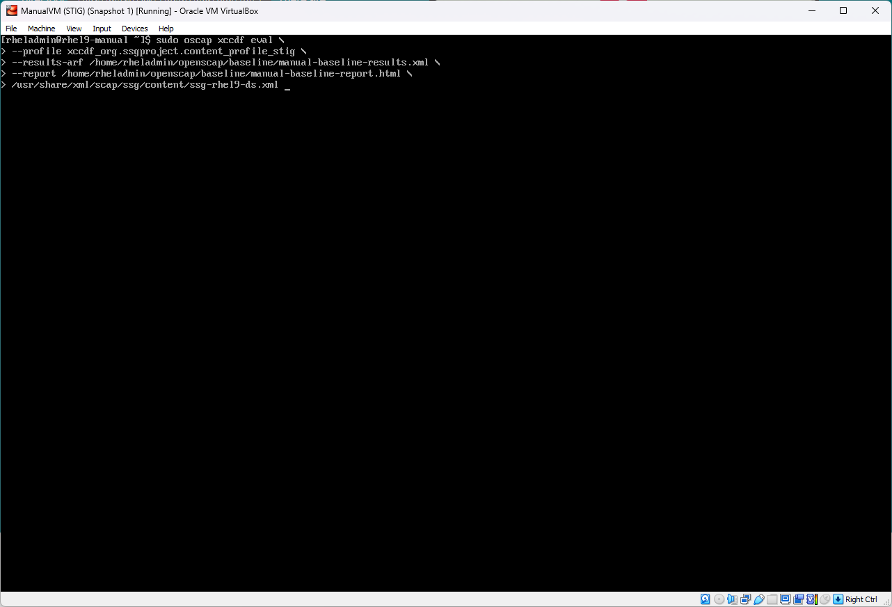
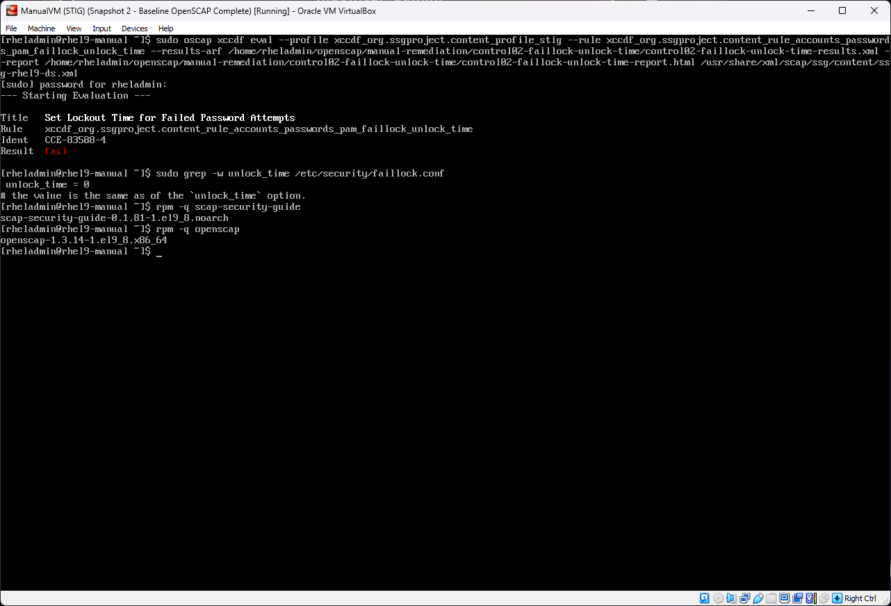
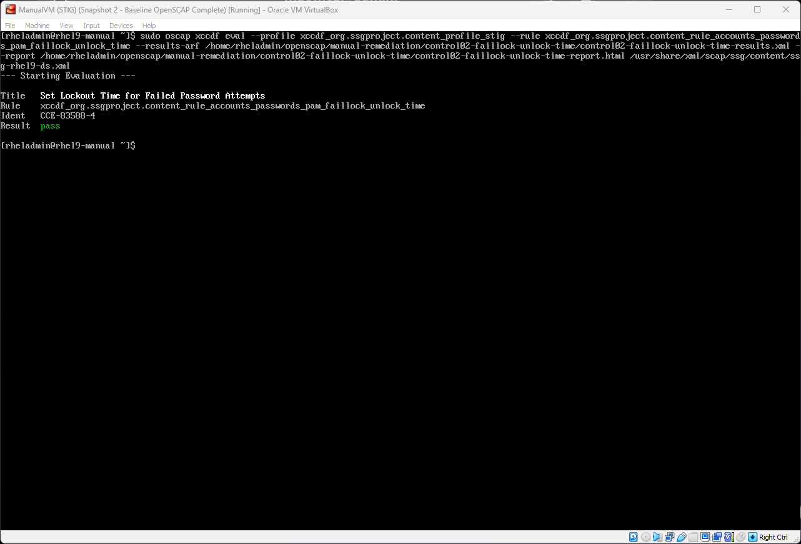
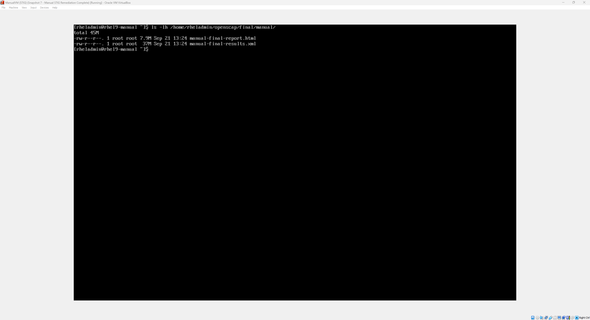
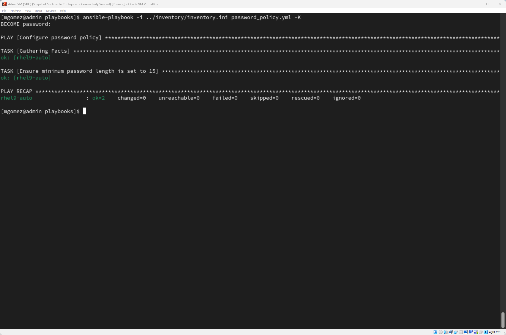
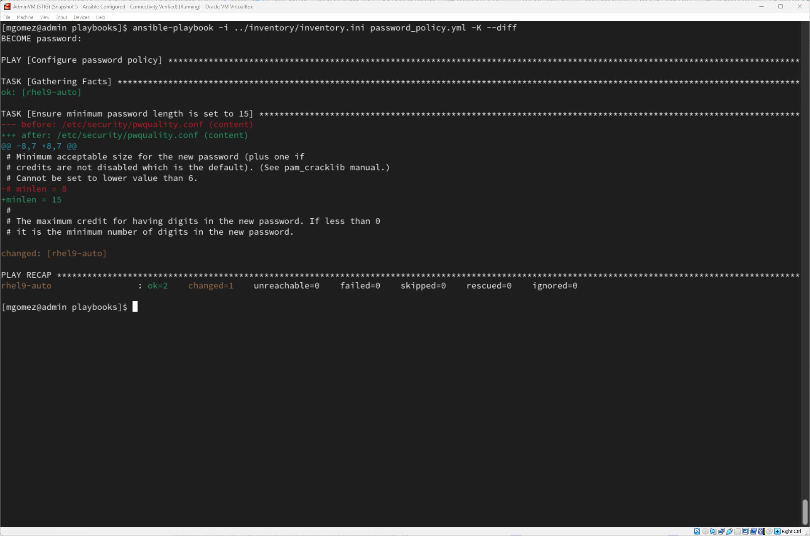
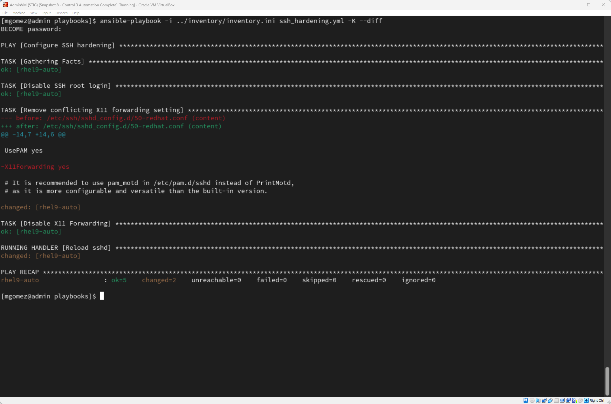
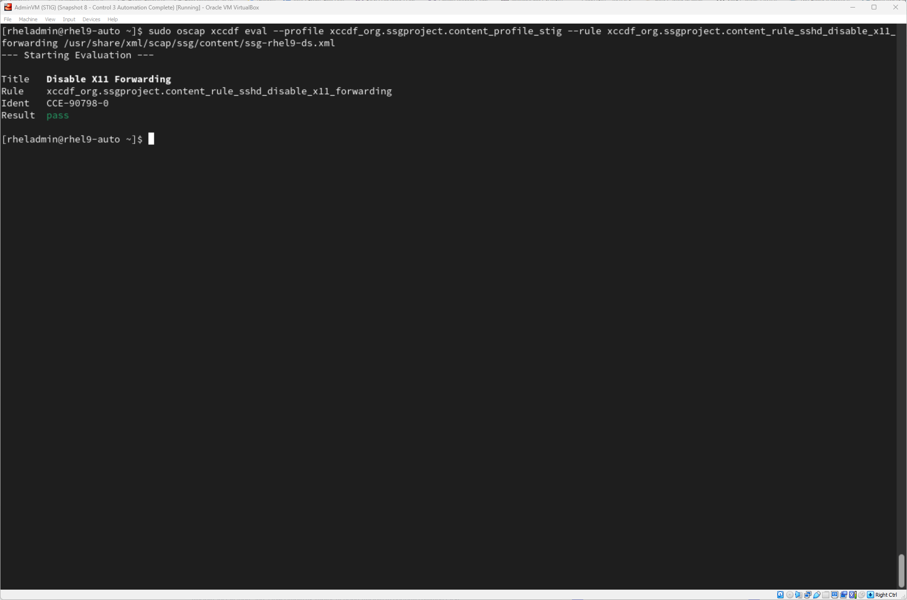
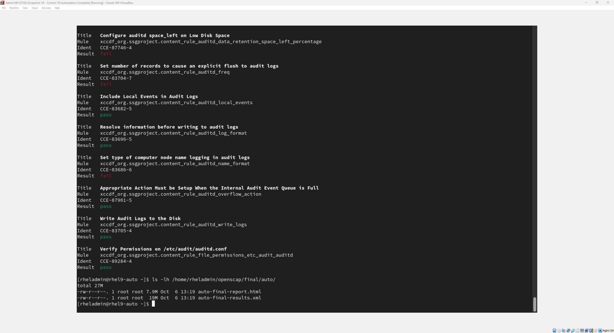

<div align="center">

# RHEL 9 STIG Remediation Lab

### Security Assessment • Manual Hardening • Ansible Automation • OpenSCAP Validation

A hands-on RHEL 9 security-hardening project demonstrating the full workflow from identifying STIG findings to manually remediating them, automating those remediations with Ansible, testing for idempotence, troubleshooting failed compliance checks, and validating the final configuration with OpenSCAP.

</div>

---

## Project Overview

This project demonstrates the assessment, remediation, automation, and validation of selected **DISA STIG security controls** on Red Hat Enterprise Linux 9.

Rather than beginning with automation, I first remediated selected findings manually on a dedicated RHEL 9 system. This allowed me to understand the underlying configuration changes, verification methods, and troubleshooting process before translating the same remediations into Ansible.

A second RHEL 9 system was then hardened using Ansible. The automation was tested for successful execution, repeatability, and **idempotence**, followed by OpenSCAP validation.

### Project Flow

```text
Build RHEL 9 Lab
       ↓
Baseline OpenSCAP Assessment
       ↓
Identify Selected STIG Findings
       ↓
Manual Remediation
       ↓
Manual Verification + OpenSCAP Validation
       ↓
Recreate Remediations with Ansible
       ↓
Test Idempotence
       ↓
Troubleshoot Failed Checks
       ↓
Final OpenSCAP Validation
```

---

## Lab Architecture

The lab was built in **Oracle VirtualBox** using three RHEL 9 virtual machines.

| System | Role |
|---|---|
| **Admin VM** | Ansible control node and central administration system |
| **Manual VM** | RHEL 9 target used for manual STIG remediation |
| **Automated VM** | RHEL 9 target used for Ansible-based remediation |

The Manual and Automated VMs originated from the same base system so that both remediation methods began from comparable configurations.

---

## Technologies Used

| Technology | Use in Project |
|---|---|
| **Red Hat Enterprise Linux 9** | Target operating system |
| **DISA STIG** | Security-hardening guidance |
| **OpenSCAP** | Compliance assessment and validation |
| **SCAP Security Guide** | RHEL 9 STIG benchmark content |
| **Ansible Core** | Automated configuration management |
| **ansible.builtin** | Core Ansible modules |
| **ansible.posix** | System configuration modules including `sysctl` |
| **SSH** | Remote administration and Ansible connectivity |
| **Oracle VirtualBox** | Virtual lab environment |
| **Git / GitHub** | Version control and project publication |

---

## Remediation Areas

The automated remediation was separated into individual playbooks by security area.

| Playbook | Security Area | Purpose |
|---|---|---|
| [`password_policy.yml`](playbooks/password_policy.yml) | Authentication | Enforces password-length requirements |
| [`account_lockout.yml`](playbooks/account_lockout.yml) | Authentication | Configures `faillock` behavior and authselect integration |
| [`ssh_hardening.yml`](playbooks/ssh_hardening.yml) | Remote Access | Disables root SSH login and X11 forwarding |
| [`cron_hardening.yml`](playbooks/cron_hardening.yml) | File Permissions | Restricts permissions on `/etc/cron.d` |
| [`file_integrity.yml`](playbooks/file_integrity.yml) | File Integrity | Installs and initializes AIDE |
| [`network_hardening.yml`](playbooks/network_hardening.yml) | Network Security | Applies IPv4 kernel hardening settings |
| [`audit_hardening.yml`](playbooks/audit_hardening.yml) | Auditing | Adds auditing for changes to privileged configuration |

---

## Manual Remediation

Selected OpenSCAP findings were first investigated and remediated manually.

For each control, I followed the same general process:

1. Identify the failed OpenSCAP rule.
2. Inspect the system's current configuration.
3. Determine the required secure state.
4. Apply the configuration change.
5. Verify the setting directly on the system.
6. Run OpenSCAP validation.
7. Troubleshoot any failed validation before continuing.

This phase was important because it established an understanding of the configuration changes **before automating them**.

### Manual Remediation Evidence

**Baseline assessment**



**Failed validation requiring additional troubleshooting**



**Successful remediation validation**



**Final OpenSCAP validation**



---

## Ansible Automation

After understanding and validating the manual remediations, I recreated the same security changes using Ansible.

The playbooks use declarative Ansible modules where appropriate and include techniques such as:

- Desired-state configuration
- Conditional execution
- Registered command output
- Handlers
- Configuration validation
- File permission management
- Package management
- Kernel parameter management
- Idempotence controls

### Example

The password-policy playbook uses `ansible.builtin.lineinfile` to ensure the required configuration exists in `/etc/security/pwquality.conf`.

```yaml
- name: Ensure minimum password length is set to 15
  ansible.builtin.lineinfile:
    path: /etc/security/pwquality.conf
    regexp: '^\s*#?\s*minlen\s*='
    line: 'minlen = 15'
    state: present
```

This allows Ansible to enforce the desired configuration instead of simply executing a one-time shell command.

---

## Idempotence Testing

An important goal was ensuring that the automation could be safely executed more than once.

After a successful remediation, each playbook was run again against the already-compliant system.

When the desired configuration was already present, Ansible reported no unnecessary changes.



This demonstrates the difference between a repeatable configuration-management workflow and a one-time remediation script.

---

## Troubleshooting

Not every remediation passed OpenSCAP on the first attempt.

Some findings required additional investigation when the visible configuration appeared correct but the compliance check still failed.

One example involved **SSH X11 forwarding**. An existing Red Hat SSH configuration file conflicted with the intended hardened configuration. The final Ansible remediation accounts for the conflicting setting before enforcing the desired state.

The project therefore included more than simply applying configuration values; it also required understanding:

- Configuration precedence
- Existing vendor configuration
- OpenSCAP evaluation behavior
- Ansible execution results
- Differences between an apparent configuration state and the effective system state

### Automation Evidence

**Running an Ansible remediation**



**Remediation after troubleshooting a failed compliance scan**



**Successful OpenSCAP validation**



**Final automated-system validation**



---

## Final Validation

Final OpenSCAP assessments were performed after completing the selected remediations on both systems.

The project demonstrated two approaches to reaching the desired secure configuration:

```text
Manual VM
OpenSCAP Finding
      ↓
Manual Investigation
      ↓
Manual Remediation
      ↓
Validation
```

```text
Automated VM
OpenSCAP Finding
      ↓
Ansible Playbook
      ↓
Repeatable Remediation
      ↓
Idempotence Test
      ↓
Validation
```

The goal was not to claim complete RHEL 9 STIG compliance, but to demonstrate the ability to **identify, understand, remediate, automate, troubleshoot, and validate selected STIG controls**.

---

## Repository Structure

```text
rhel9-stig-remediation-lab/
│
├── README.md
├── .gitignore
│
├── evidence/
│   ├── automated-remediation/
│   └── manual-remediation/
│
├── inventory/
│   └── inventory.example.ini
│
└── playbooks/
    ├── account_lockout.yml
    ├── audit_hardening.yml
    ├── cron_hardening.yml
    ├── file_integrity.yml
    ├── network_hardening.yml
    ├── password_policy.yml
    └── ssh_hardening.yml
```

---

## Example Inventory

The repository uses a sanitized example inventory instead of the inventory from the original lab.

```ini
[stig_targets]
rhel9-target ansible_host=192.0.2.10 ansible_user=adminuser
```

Replace the example address and username with values appropriate for the target environment.

---

## Running a Playbook

The Ansible control system requires:

- Ansible Core
- SSH connectivity to the target
- Privilege escalation permissions
- The `ansible.posix` collection for the network-hardening playbook

Install the required collection:

```bash
ansible-galaxy collection install ansible.posix
```

Example playbook execution:

```bash
ansible-playbook -i inventory/inventory.example.ini playbooks/password_policy.yml
```

> **Note:** The example inventory must be modified for the target environment before execution.

---

## Security and Repository Sanitization

The public repository intentionally excludes environment-specific and sensitive information.

Excluded material includes:

- Actual lab IP addresses
- Original Ansible inventory
- SSH private keys
- Credentials
- Red Hat subscription information
- Raw OpenSCAP HTML/XML reports containing system metadata
- Internal project notes
- SOPs
- Interview-preparation material

A sanitized inventory and selected screenshots are provided instead.

---

## Key Takeaways

This project reinforced several important system-administration and security concepts:

- Security controls should be understood before they are automated.
- A configuration that appears correct may still require troubleshooting during compliance validation.
- Ansible enables security settings to be represented as repeatable desired state.
- Idempotence is essential for reliable configuration management.
- Automated compliance tools such as OpenSCAP provide an additional layer of verification beyond manual inspection.
- Security automation requires understanding both the configuration-management tool and the underlying operating system.

---

<div align="center">

### RHEL 9 • STIG • OpenSCAP • Ansible

**Manual hardening translated into repeatable security automation**

</div>